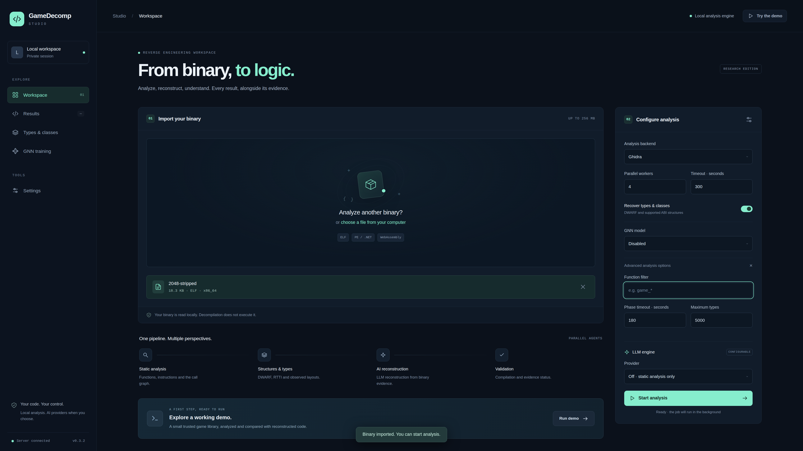
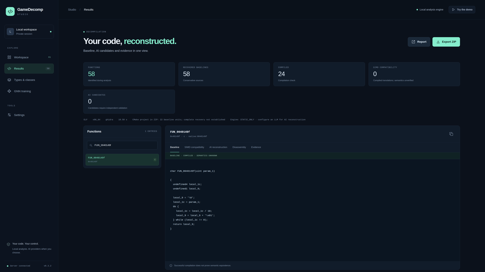
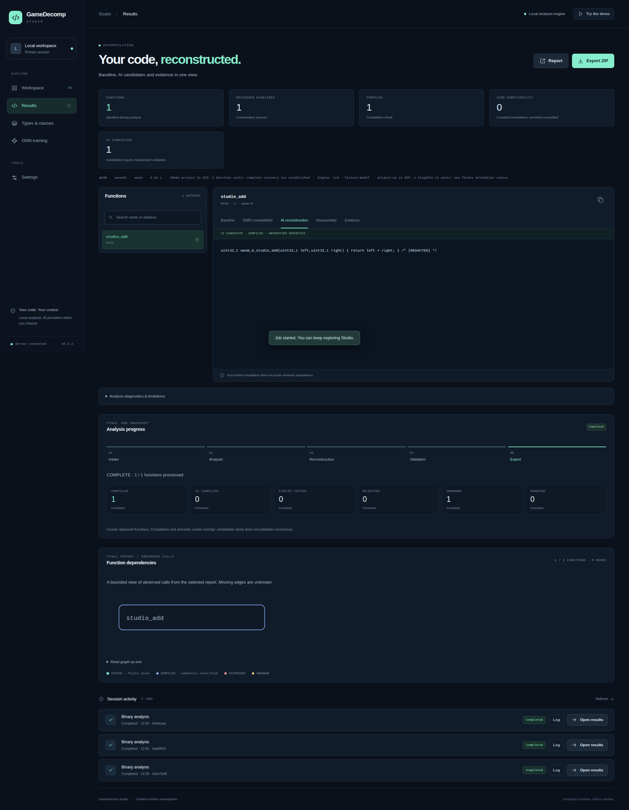
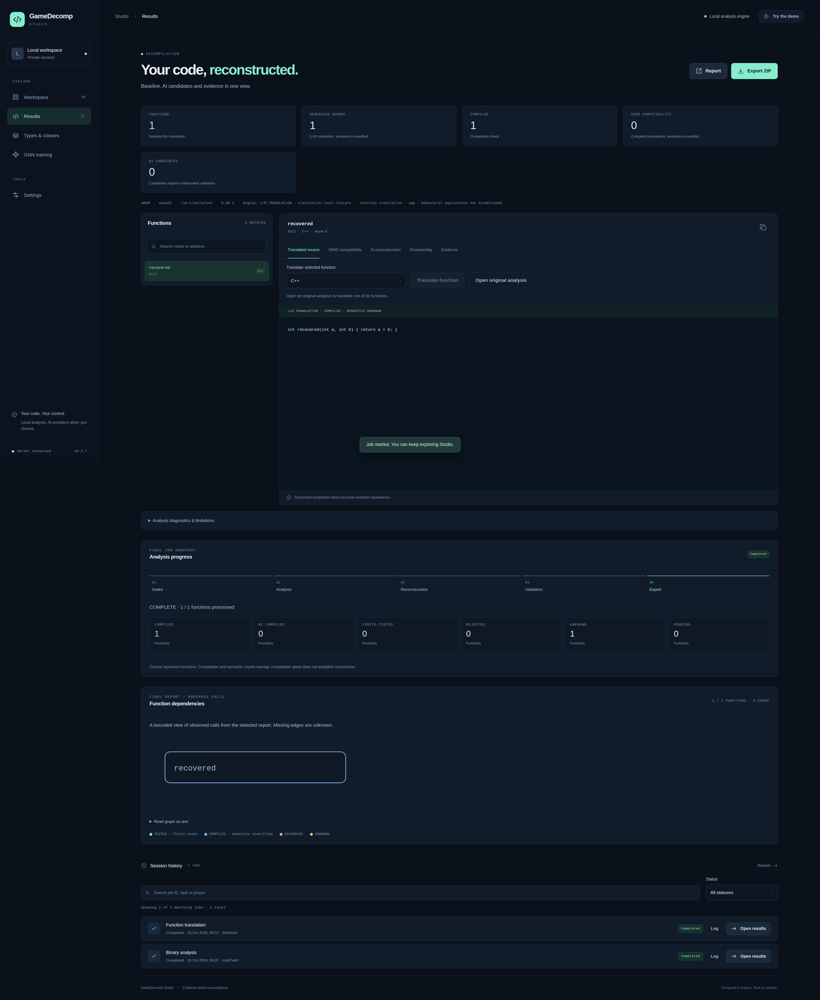
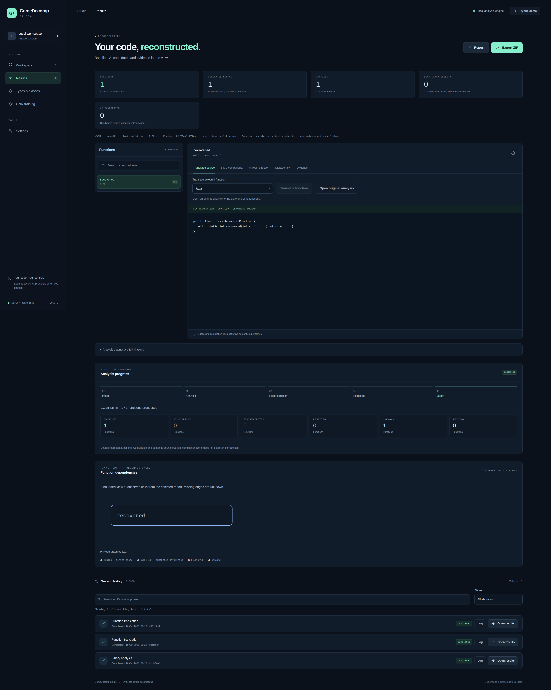
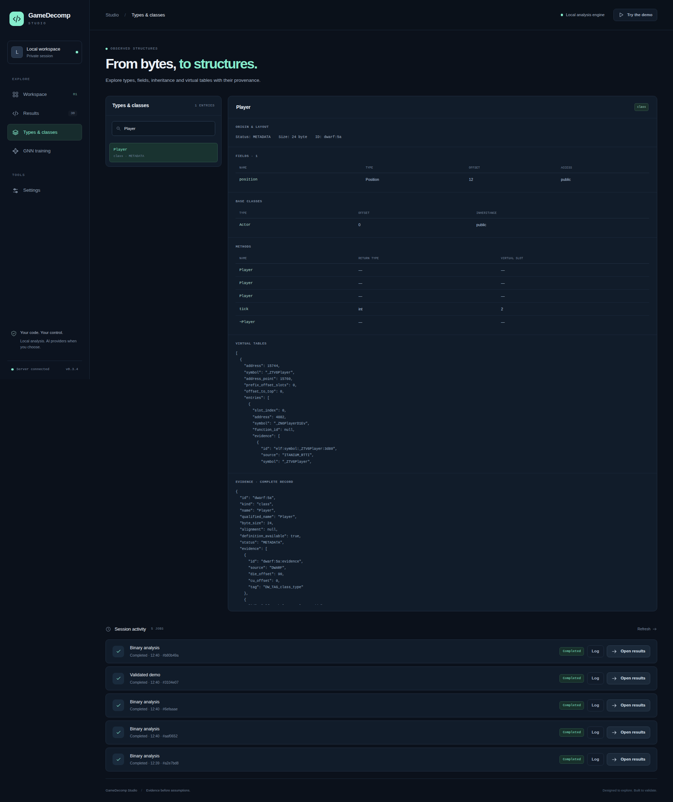
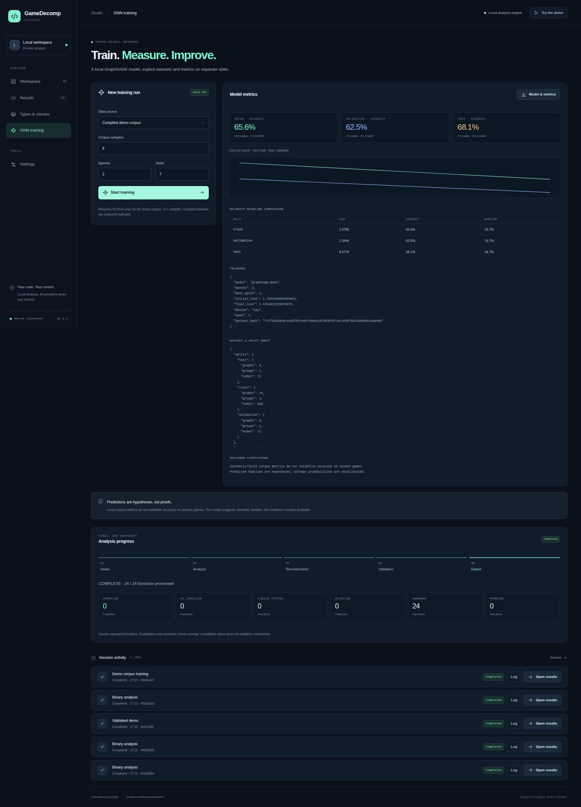
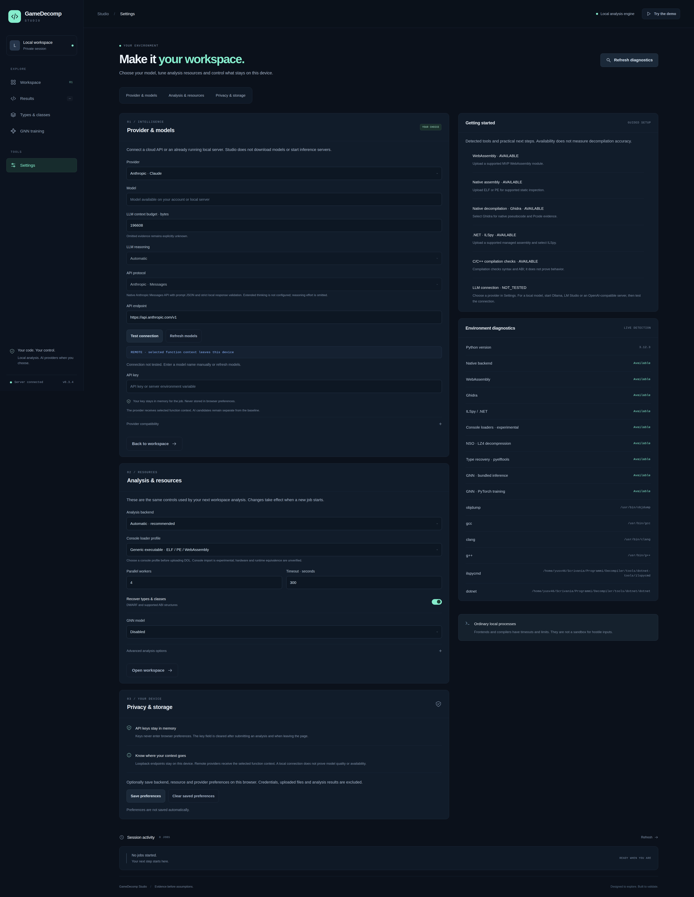
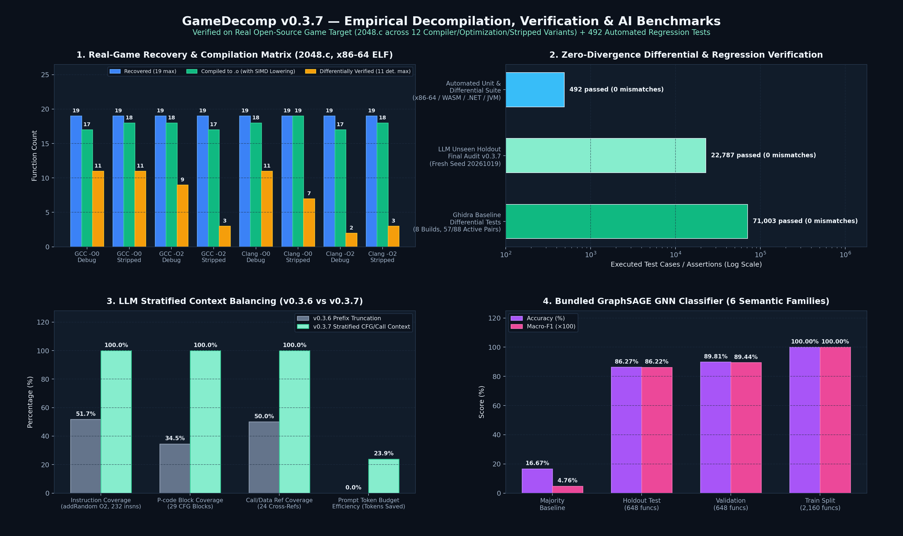

# GameDecomp — Evidence-Driven Binary Decompiler, SIMD/CFG Lifter & AI Reconstruction Studio

[](LICENSE)
[](pyproject.toml)
[](pyproject.toml)
[](tests/)
[-f59e0b.svg)](docs/REAL_GAME_BENCHMARK.md)

**GameDecomp** is an evidence-driven binary decompilation, static analysis, and AI-assisted source reconstruction toolkit engineered for native executables (`ELF`, `PE`, `Mach-O`), **WebAssembly** (`.wasm`), **.NET assemblies** (`.dll` / `.exe`), and **JVM bytecode** (`.class` / `.jar`).

Unlike opaque LLM wrappers that hallucinate unverified source code, GameDecomp anchors every recovery step in **verifiable binary evidence**:
1. **Deterministic Static & IR Lifters:** Native x86-64 ELF lifter, headless **Ghidra** P-code integration, pure-Python **WebAssembly** stack-to-expression lifter, **ILSpy** (.NET), and **CFR** (JVM).
2. **Formal CFG, Dominance & SSA Evidence Engine:** Computes Cooper–Harvey–Kennedy immediate dominators (`idom`), post-dominators (`ipdom`), dominance frontiers, natural back-edge loops, backward register liveness (`live_in` / `live_out`), and Cytron–Ferrante iterated dominance frontier SSA $\phi$-node placement.
3. **Hardware-Verified Ghidra SIMD & P-code Lowering:** Rewrites raw Ghidra intrinsics (`pshufd`, `pmovmskb`, `punpck*`, `padd*`, `psub*`, `pcmpeq*`, `pcmpgt*`, `pmin*`, `pmax*`, `pand/por/pxor`, `CARRY*`, `SCARRY*`, `SBORROW*`, `POPCOUNT`) and 128-bit packed array pointer stores (`(undefined1 [16])0x0`) into portable, bit-exact ISO C99 verified directly against native x86-64 silicon.
4. **Zero-Dependency GraphSAGE GNN Classifier:** Includes a locally trained 2-layer GraphSAGE model (`gamedecomp/data/gnn_family.json`, **86.27% test accuracy / 0.8622 macro-F1**) that classifies functions into semantic families using pure Python standard-library inference.
5. **Closed-Loop LLM Reconstruction & Function Translation:** Connects to local servers (**Ollama**, **LM Studio**, **vLLM**, **llama.cpp**) or remote APIs (**DeepSeek**, **OpenAI-compatible**, **Anthropic Claude Messages API**) with stratified CFG context balancing, strict compiler validation (`gcc`/`clang`/`g++`/`javac`), and finite differential oracle verification (`TESTED` vs `COMPILED` vs `UNKNOWN`).

---

## Table of Contents

- [GameDecomp Studio — Interface Gallery](#gamedecomp-studio--interface-gallery)
- [Empirical Benchmarks & Verification Matrix](#empirical-benchmarks--verification-matrix)
- [Core Architecture & Key Capabilities](#core-architecture--key-capabilities)
- [Supported Binary Formats & Backends](#supported-binary-formats--backends)
- [Installation Guide](#installation-guide)
- [How to Use GameDecomp (Studio UI & CLI)](#how-to-use-gamedecomp)
- [Verification Guarantees & Engineering Scope](#verification-guarantees--engineering-scope)
- [Documentation Index](#documentation-index)
- [SEO Keywords & Topics](#seo-keywords--topics)

---

## GameDecomp Studio — Interface Gallery

GameDecomp includes **GameDecomp Studio**, a self-hosted local web application (`python3 -m gamedecomp ui`) with real-time pipeline telemetry, interactive call-graph visualization, side-by-side baseline/SIMD/AI code inspection, DWARF/RTTI type exploration, and persistent session history.

### 1. Workspace & Binary Intake
Import `ELF`, `PE/.NET`, or `WebAssembly` binaries up to 256 MB, configure parallel workers, enable DWARF/RTTI type recovery, select the GraphSAGE GNN classifier, and attach an optional local or remote LLM engine.



### 2. Real-Game Decompilation Results (`2048` Stripped x86-64 ELF)
Inspect recovered baseline C functions, compilation status, SIMD compatibility lowers, disassembly, and structured JSON evidence side by side, or export a ready-to-build CMake project archive (`Export ZIP`).



### 3. AI Reconstruction, Pipeline Telemetry & Call-Graph Dependencies
Track the 5-stage analysis pipeline (`Intake → Analysis → Reconstruction → Validation → Export`), inspect AI-reconstructed candidates with explicit semantic badges (`TESTED`, `COMPILED · UNVERIFIED SEMANTICS`, `REJECTED`), and browse the interactive function dependency graph.



### 4. Post-Decompilation Function Translation (C++17 & Java)
Translate individual recovered functions into **C++17** (`RecoveredFunction.cpp`) or **Java** (`RecoveredFunction.java`) with automated `g++`/`clang++` or `javac`/`javap` structural verification and SHA-256 provenance tracking.

| C++17 Validated Translation | Java Bytecode-Verified Translation |
| :---: | :---: |
|  |  |

### 5. DWARF v4/v5, C++ RTTI & ABI Types Browser
Explore recovered `struct`, `class`, `union`, and `enum` definitions with byte offsets, field sizes, virtual bases, vtable methods, and ABI layouts.



### 6. GraphSAGE GNN Training & Evaluation Console
Generate multi-compiler training corpora (`GCC` / `Clang` across `-O0`, `-O1`, `-O2`), train custom GraphSAGE checkpoints, and inspect holdout accuracy and macro-F1 directly in Studio.



### 7. Multi-Provider LLM Engine & Local Toolchain Diagnostics
Configure **Anthropic Claude (native Messages API)**, **DeepSeek**, **Ollama**, **LM Studio**, or custom OpenAI-compatible gateways with in-memory API key isolation and live toolchain health checks.



---

## Empirical Benchmarks & Verification Matrix



### 1. Real Open-Source Game Benchmark (`2048.c` across 8 Compiler/Optimization/Stripped Builds)

GameDecomp was benchmarked end-to-end on the real open-source terminal game [`2048.c`](https://github.com/mevdschee/2048.c) compiled across **8 x86-64 ELF variants** (`GCC` and `Clang`, `-O0` and `-O2`, with DWARF debug symbols and fully `strip`ped).

- **19 / 19 functions recovered (100%)** across all 8 binary variants (`152 / 152` total functions recovered).
- **142 / 152 functions (93.4%) compile cleanly to object code (`.o`)**—including `initBoard` in `GCC -O2` where the compiler vectorizes board initialization into 128-bit `movups` pointer-to-packed-array stores (`*param_1 = (undefined1 [16])0x0;`), lowered automatically by [`ghidra_compat.py`](gamedecomp/ghidra_compat.py).
- **71,003 finite differential test comparisons executed with 0 mismatches** against the ground-truth reference oracle across the 11 deterministic game-logic functions (`57 / 88` function-build pairs verified end-to-end without manual edits).

| Build Variant | Compiler & Flags | Stripped | Functions Recovered | Raw Ghidra `.o` | SIMD-Lowered `.o` | Differentially Verified (of 11 Det.) | Finite Oracle Cases Passed | Mismatches |
| :--- | :--- | :---: | :---: | :---: | :---: | :---: | :---: | :---: |
| `gcc-O0-debug` | `gcc -O0 -g` | No | 19 / 19 | 17 / 19 | 17 / 19 | 11 / 11 | 13,308 | **0** |
| `gcc-O0-stripped` | `gcc -O0 -s` | Yes | 19 / 19 | 18 / 19 | 18 / 19 | 11 / 11 | 13,308 | **0** |
| `gcc-O2-debug` | `gcc -O2 -g` | No | 19 / 19 | 9 / 19 | 18 / 19 | 9 / 11 | 12,784 | **0** |
| `gcc-O2-stripped` | `gcc -O2 -s` | Yes | 19 / 19 | 6 / 19 | 17 / 19 | 3 / 11 | 830 | **0** |
| `clang-O0-debug` | `clang -O0 -g` | No | 19 / 19 | 15 / 19 | 18 / 19 | 11 / 11 | 13,308 | **0** |
| `clang-O0-stripped` | `clang -O0 -s` | Yes | 19 / 19 | **19 / 19** | **19 / 19** | 7 / 11 | 10,164 | **0** |
| `clang-O2-debug` | `clang -O2 -g` | No | 19 / 19 | 6 / 19 | 17 / 19 | 2 / 11 | 567 | **0** |
| `clang-O2-stripped` | `clang -O2 -s` | Yes | 19 / 19 | 6 / 19 | 18 / 19 | 3 / 11 | 6,734 | **0** |
| **Total** | **8 Real Builds** | **4 Debug / 4 Stripped** | **152 / 152 (100%)** | **96 / 152 (63.2%)** | **142 / 152 (93.4%)** | **57 / 88 (64.8%)** | **71,003** | **0** |

### 2. Expanded 12-Build LLM Reconstruction & Unseen Holdout Audit (`v0.3.7`)

On an expanded matrix of **12 builds** (adding `-O2 -fPIE -pie` and `-O2 -flto` stripped variants for both GCC and Clang) and **22 challenging function targets** (`11` functions where Ghidra baseline failed isolated compilation or lacked callee closure, plus `11` stripped `-O2` functions with synthesized `FUN_*` symbols):

- **Stratified Context Balancing (`v0.3.7`):** Replaces naive prefix truncation with stratified sampling across instructions, P-code blocks, and call/data cross-references. On the 232-instruction `addRandom` (`gcc-O2-stripped`) target, instruction coverage jumped from **51.7% → 100.0%**, P-code block coverage from **34.5% → 100.0%**, and call/data reference coverage from **50.0% → 100.0%**, while reducing total prompt tokens across the 13-case benchmark from **64,904 → 49,393 (-23.9%)**.
- **Unseen Final Holdout Audit:** Evaluated on **22,787 fresh random states** (`seed = 20261018`, zero overlap with development seeds), **11 / 12 executable AI reconstructions passed 22,787 / 22,787 unseen test cases with 0 divergences** (including `slideArray`, `rotateBoard`, `moveUp`, `moveLeft`, `moveDown`, `moveRight`, `findPairDown`, `countEmpty`, `gameEnded`, and `addRandom`).

### 3. Bundled GraphSAGE GNN Semantic Family Classifier

The bundled model [`gamedecomp/data/gnn_family.json`](gamedecomp/data/gnn_family.json) is a 2-layer GraphSAGE network (`32` topological/instruction/ABI features, `32` hidden units, mean neighborhood aggregation) trained on `3,456` functions (`288` call graphs across GCC and Clang at `-O0`, `-O1`, `-O2` with strict template-group split isolation):

| Split | Call Graphs | Template Groups | Functions | Accuracy | Macro-F1 |
| :--- | :---: | :---: | :---: | :---: | :---: |
| **Majority Baseline** | 54 | 3 | 648 | 16.67% | 0.0476 |
| **Holdout Test Split** | **54** | **3** | **648** | **86.27%** | **0.8622** |
| **Validation Split** | 54 | 3 | 648 | 89.81% | 0.8944 |
| **Train Split** | 180 | 3 | 2,160 | 100.00% | 1.0000 |

---

## Core Architecture & Key Capabilities

```
Binary (.elf / .exe / .dll / .wasm / .class / .jar)
  │
  ├─► Static Lifters ──► [Ghidra Headless P-code] / [Native x86-64] / [WASM Lifter] / [ILSpy] / [CFR]
  │
  ├─► Evidence & CFG Engine (gamedecomp/evidence.py)
  │     ├── Basic Block CFG & Edge Classification (fallthrough, branch, conditional, call)
  │     ├── Cooper-Harvey-Kennedy Immediate Dominators (idom), Post-Dominators (ipdom) & Frontiers
  │     ├── Natural Back-Edge Loop Detection, Nesting Depth & Reducibility Analysis
  │     ├── Backward Register Liveness (live_in / live_out) & Entry Argument Detection
  │     └── Iterated Dominance Frontier SSA Phi-Node Placement (phi_candidates)
  │
  ├─► Type & Class Recovery (gamedecomp/dwarf_types.py, rtti.py)
  │     ├── DWARF v4/v5 Structs, Classes, Unions, Enums, Bitfields & Base Offsets
  │     └── Itanium ABI & MSVC C++ RTTI / Vtable Recovery
  │
  ├─► Ghidra SIMD & P-code Compatibility Lowering (gamedecomp/ghidra_compat.py)
  │     ├── 26 Hardware-Verified SSE2 & P-code Bit-Vector Models (pshufd, pmovmskb, punpck*, etc.)
  │     └── 128-bit Packed Array Pointer Store Lowering (*ptr = (undefined1 [16])0x0)
  │
  ├─► GraphSAGE GNN Semantic Classifier (gamedecomp/gnn.py)
  │     └── Pure-Python Inference across 6 Families (arithmetic, bitwise, comparison, float_math, memory_read, memory_write)
  │
  └─► Closed-Loop LLM Reconstruction, Translation & Verification (gamedecomp/ai_engine.py, validation.py)
        ├── Stratified Prompt Context Balancing (Instructions, P-code, Call/Data Cross-Refs)
        ├── Strict Compiler Gate (gcc / clang / g++ / javac / javap)
        └── Finite Differential Oracle Execution (TESTED vs COMPILED vs UNKNOWN)
```

### Highlights of the v0.3.7 Engine

- **26 Hardware-Verified SIMD & P-code Intrinsics (`gamedecomp/ghidra_compat.py`):**
  Translates uncompilable Ghidra decompiler intrinsics into standard C99 helpers verified bit-for-bit against native x86-64 instructions (`pshufd` 2/3-arg, `pmovmskb` 1/2-arg, `punpcklbw/hbw/lwd/hwd/ldq/hdq/lqdq/hqdq`, `paddb/w/d/q`, `psubb/w/d/q`, `pcmpeqb/w/d`, `pcmpgtb/w/d`, `pminub/maxub/minsw/maxsw`, `pand/pandn/por/pxor`, `CARRY1/2/4/8`, `SCARRY1/2/4/8`, `SBORROW1/2/4/8`, `POPCOUNT`, `ZEXT*`, `SEXT*`, `CONCAT*`, `SUB*`).
- **Complete WebAssembly Stack Lifter (`gamedecomp/backends/wasm.py`):**
  Pure-Python `.wasm` parser and stack-to-C expression lifter supporting `i32`/`i64` arithmetic, bitwise shifts (`shl`, `shr_u`, `shr_s`), rotations (`rotl`, `rotr`), bit-counting (`clz`, `ctz`, `popcnt` with zero-input guards), all 20 signed/unsigned relational operators (`eq`, `ne`, `lt_s/u`, `gt_s/u`, `le_s/u`, `ge_s/u`), `eqz`, ternary `select`, and integer width/sign conversions (`wrap_i64`, `extend_i32_s/u`, `extend8/16/32_s`).
- **Native x86-64 Fast Lifter (`gamedecomp/backends/native.py`):**
  Zero-Ghidra fast path for straight-line System V AMD64 functions covering arithmetic (`add`, `sub`, `imul`, `inc`, `dec`, `neg`), bitwise/rotates (`and`, `or`, `xor`, `not`, `shl`, `shr`, `sar`, `rol`, `ror`, `bswap`), sign/zero extensions (`movzx`, `movsx`, `movsxd`/`movslq`, `cdqe`/`cltq`), register exchanges (`xchg`), conditional moves (`cmov*`), `cmp`/`test` + `setcc`, and `lea`.

---

## Supported Binary Formats & Backends

| Format / Target | Backend Option | External Tool Required | Capabilities & Scope |
| :--- | :--- | :--- | :--- |
| **ELF / PE / Mach-O** (`x86`, `x86-64`, `ARM`, `AArch64`) | `--backend ghidra` / `auto` | Headless Ghidra (`analyzeHeadless`) | Full CFG/P-code decompilation, SIMD compatibility lowering, DWARF & RTTI recovery, CMake project export |
| **ELF `x86-64`** (Fast Static Subset) | `--backend native` / `auto` | `objdump`, `nm`, `readelf` | Fast pure-Python lifting for straight-line System V AMD64 integer functions |
| **WebAssembly (`.wasm`)** | `--backend wasm` / `auto` | **None** (Pure Python) | Custom binary section parser + stack machine lifter for straight-line `i32`/`i64` functions |
| **.NET Assemblies (`.dll` / `.exe`)** | `--backend ilspy` / `auto` | `ilspycmd` + .NET runtime | Full C# decompilation and type extraction |
| **JVM Bytecode (`.class` / `.jar`)** | `--backend cfr` / `auto` | `java` + CFR `.jar` | Full Java source recovery from `.class` and `.jar` archives |

---

## Installation Guide

### 1. System Prerequisites

- **Operating System:** Linux (`x86-64` recommended for native ELF lifting and hardware-verified SIMD tests)
- **Python:** Python `3.11` or newer (`python3 --version`)
- **Standard C/C++ Toolchain (recommended for compiler verification gates):** `gcc`, `g++`, `clang`, and GNU `binutils` (`objdump`, `nm`, `readelf`)

```bash
# Ubuntu / Debian example
sudo apt update && sudo apt install -y python3 python3-pip python3-venv build-essential clang binutils
```

### 2. Clone & Install GameDecomp

GameDecomp's core engine, WebAssembly lifter, GraphSAGE GNN inference, LLM client, and Studio web UI require **zero mandatory third-party Python libraries**:

```bash
git clone https://github.com/shortsspectrumai-del/GameDecomp.git
cd GameDecomp

# Create and activate a virtual environment (optional but recommended)
python3 -m venv .venv
source .venv/bin/activate

# Install GameDecomp in editable mode
pip install -e .
```

#### Optional Python Extras

You can install optional extras depending on the features you need:

```bash
# Enhanced DWARF v4/v5 type parsing (pyelftools) + Nintendo Switch NSO LZ4 decompression
pip install -e ".[types,console]"

# PyTorch CPU for training custom GraphSAGE GNN models (inference works without PyTorch!)
pip install -e ".[training]"
```

### 3. Configuring Optional External Decompiler Backends

GameDecomp automatically detects external backends on your `PATH` or via environment variables (or inside `./tools/` when launched via `./start-studio.sh`):

| Backend | Target Binaries | How to Configure |
| :--- | :--- | :--- |
| **Ghidra Headless** | Native `ELF`, `PE`, `Mach-O`, Console ROMs (`x86`, `x86-64`, `ARM`, `AArch64`, `MIPS`, `PowerPC`) | Install JDK 21 (`JAVA_HOME`) and Ghidra 11/12, then set `export GHIDRA_HOME=/path/to/ghidra` or pass `--ghidra-home` |
| **ILSpy CLI (`ilspycmd`)** | `.NET` / Unity Managed Assemblies (`.dll`, `.exe`) | Install .NET SDK/Runtime and `dotnet tool install -g ilspycmd` (ensure `ilspycmd` is in `PATH`) |
| **CFR (`cfr.jar`)** | Java / JVM Bytecode (`.class`, `.jar`) | Install `java` (`JAVA_HOME`) and set `export CFR_JAR=/path/to/cfr.jar` or pass `--cfr-jar` |
| **Built-in Native & WASM** | `.wasm` modules & straight-line `x86-64` ELF | **Included out of the box** (no external decompiler needed) |

---

## How to Use GameDecomp

### Option A: Using GameDecomp Studio (Interactive Web UI)

#### 1. Start the Studio Server

```bash
# Standard launch (binds strictly to local loopback 127.0.0.1:8765)
python3 -m gamedecomp ui --host 127.0.0.1 --port 8765 --workspace ~/.gamedecomp-studio

# Or use the helper script to auto-detect local tools in ./tools/
./start-studio.sh --port 8765 --workspace ~/.gamedecomp-studio
```

Open **`http://127.0.0.1:8765`** in your browser.

#### 2. Run the Built-In Interactive Demo
- Click **"Try the demo"** (top-right button) or **"Run demo"** on the Workspace home screen.
- GameDecomp compiles a sample C game library, runs static analysis, recovers functions and types, verifies compilation, and opens the **Results** dashboard automatically.

#### 3. Analyze Your Own Binary (`ELF`, `PE / .NET`, `WebAssembly`, or Console Binary)
1. In **01 · Import your binary**, drag-and-drop your executable/library (up to 256 MB) or click **choose a file from your computer**.
2. In **02 · Configure analysis**:
   - **Analysis backend:** Choose `Automatic`, `Ghidra`, `Native ELF`, `WebAssembly`, `ILSpy · .NET`, or `CFR · JVM`.
   - **Parallel workers & Timeout:** Set worker concurrency (e.g., `4`) and per-phase timeout.
   - **Recover types & classes:** Keep enabled to extract DWARF v4/v5 structs, unions, enums, and C++ RTTI vtables.
   - **GNN model:** Select `Built-in GraphSAGE` to classify functions into semantic families (`arithmetic`, `bitwise`, `comparison`, `float_math`, `memory_read`, `memory_write`).
3. Click **"Start analysis"**. Progress updates live across the 5 stages (`Intake → Analysis → Reconstruction → Validation → Export`).

#### 4. Enable AI Reconstruction (Local Ollama / LM Studio or Cloud APIs)
1. Open **Settings** in the left sidebar.
2. Under **LLM engine**, select your provider:
   - **Ollama (local)** (`http://127.0.0.1:11434/v1`) or **LM Studio (local)** (`http://127.0.0.1:1234/v1`) — 100% offline/local inference.
   - **Anthropic · Claude** — Native Messages API (`/v1/messages`).
   - **DeepSeek** or **Custom API** (OpenAI Chat Completions or Anthropic Messages compatible).
3. If using a cloud provider, enter your API key in the protected password field (held **only in volatile RAM** for the session; never saved to disk or exported).
4. Click **Test connection / Refresh models**, pick your model, and run an analysis with the LLM engine enabled.

#### 5. Translate a Recovered Function to C++17 or Java
1. After an analysis finishes, open **Results** and select a function from the left list.
2. Choose **Baseline** or **AI reconstruction** as the source basis.
3. Select **C++** or **Java** in the **Translate selected function** dropdown and click **Translate function**.
4. Studio runs the LLM translation, validates the generated code with `g++`/`clang++` (`-std=c++17`) or `javac`/`javap`, and provides a downloadable `Export ZIP` containing `RecoveredFunction.cpp` or `RecoveredFunction.java`.

---

### Option B: Command-Line Interface (CLI) Reference

#### 1. Run the Self-Contained End-to-End Demo
Compiles a synthetic C library, runs decompilation, executes finite differential oracle tests, and generates both `report.json` and `report.html`:

```bash
python3 -m gamedecomp demo -o demo-run
```

#### 2. Inspect Binary Metadata & Sections Quickly
```bash
python3 -m gamedecomp inspect path/to/binary --json
```

#### 3. Decompile Native Binaries, WebAssembly, .NET, or JVM Targets
```bash
# Headless Ghidra decompilation + SIMD compatibility lowering + built-in GraphSAGE GNN
python3 -m gamedecomp analyze path/to/game_binary -o out-ghidra \
  --backend ghidra \
  --ghidra-home /path/to/ghidra_12.1.4_PUBLIC \
  --gnn-model builtin \
  --workers 4

# Pure-Python WebAssembly (.wasm) decompilation (zero external dependencies)
python3 -m gamedecomp analyze path/to/module.wasm -o out-wasm --backend wasm

# Fast pure-Python x86-64 ELF lifting
python3 -m gamedecomp analyze path/to/libgame.so -o out-native --backend native

# .NET assembly (C#) decompilation via ILSpy
python3 -m gamedecomp analyze path/to/Assembly-CSharp.dll -o out-dotnet --backend ilspy

# JVM (.jar / .class) decompilation via CFR
python3 -m gamedecomp analyze path/to/game.jar -o out-jvm --backend cfr --cfr-jar /path/to/cfr.jar
```

#### 4. AI-Assisted Reconstruction via CLI (Ollama, DeepSeek, Anthropic Claude)
```bash
# Local Ollama / LM Studio / vLLM server (no API key required)
python3 -m gamedecomp analyze path/to/game_binary -o out-ollama \
  --backend ghidra \
  --llm-url http://127.0.0.1:11434/v1 \
  --llm-model qwen2.5-coder:14b

# DeepSeek API (using environment variable or interactive --llm-key-prompt)
export DEEPSEEK_API_KEY="your_api_key_here"
python3 -m gamedecomp analyze path/to/game_binary -o out-deepseek \
  --backend ghidra \
  --llm-provider deepseek \
  --llm-model deepseek-chat

# Anthropic Claude Native Messages API
export ANTHROPIC_API_KEY="your_api_key_here"
python3 -m gamedecomp analyze path/to/game_binary -o out-claude \
  --backend ghidra \
  --llm-provider anthropic \
  --llm-model claude-sonnet-4-20250514 \
  --llm-max-output-tokens 4096
```

#### 5. Extract DWARF v4/v5 & C++ RTTI Types to a C/C++ Header
```bash
python3 -m gamedecomp types path/to/game_binary -o recovered_types.h --json recovered_types.json
```

#### 6. Console Binary Loader Profiles (Switch, PS1, GBA, GameCube/Wii, NES, Genesis)
```bash
# Inspect or analyze a console binary with an explicit loader profile
python3 -m gamedecomp inspect path/to/homebrew.nro --console-profile switch_nro --json
python3 -m gamedecomp analyze path/to/homebrew.dol -o out-dol --console-profile gamecube_wii_dol --backend ghidra
```

#### 7. Train or Evaluate a GraphSAGE GNN Model
```bash
# Generate a multi-compiler C corpus, train a GraphSAGE checkpoint, and evaluate holdout metrics
python3 -m gamedecomp gnn-demo -o gnn-training-run --samples 48 --epochs 120 --seed 17
```

#### 8. Run the Test Suite & Release Verifier (492 Tests)
```bash
python3 -m unittest discover -s tests -v
python3 scripts/verify_release.py
```

---

## Verification Guarantees & Engineering Scope

GameDecomp enforces a strict separation between **observed binary facts**, **compilable code**, and **differentially tested equivalence**:

- **`COMPILED` $\neq$ Semantically Equivalent:** A function marked `COMPILED` has passed syntax, type, and object compilation (`gcc`/`clang`/`g++`/`javac`) with zero unresolved Ghidra placeholders (`BADSPACEBASE`, `unaff_*`, `in_*`, `extraout_*`), but its runtime behavior remains `UNKNOWN` unless validated by an executable oracle.
- **`TESTED` (Finite Differential Verification):** Awarded only when the compiled candidate executes against a trusted reference oracle across finite test vectors with **0 divergences**. Finite testing bounds behavioral confidence on the tested inputs and does not constitute unbounded formal verification (SMT/proof).
- **`HYPOTHESIS` (GNN & Heuristic Labels):** GraphSAGE GNN family predictions and heuristic variable names are explicitly labeled `HYPOTHESIS` and never overwrite baseline recovery or promote unverified code.
- **Safe Non-Executing Analysis:** Binary intake and static analysis never execute the target binary. Differential validation compiles and executes isolated test harnesses only when explicitly invoked by the user or benchmark suite.

---

## Documentation Index

- **[Real-Game Benchmark Report (`2048.c`)](docs/REAL_GAME_BENCHMARK.md)** — Full 8-build and 12-build empirical evaluation, compilation matrix, and differential oracle results.
- **[Release 0.3.7 Verification & Unseen Holdout Audit](docs/COLLAUDO_0_3_7.md)** — Stratified LLM context balancing metrics and 22,787-case unseen holdout audit.
- **[Post-Decompilation Function Translation (C++17 & Java)](docs/FUNCTION_TRANSLATION.md)** — Workflow, compiler gates, and provenance guarantees for C++17 and Java translation.
- **[Anthropic Claude Native Messages Integration](docs/ANTHROPIC.md)** — Configuration, token budgeting, and security model for Anthropic API integration.
- **[GraphSAGE GNN Model Card (`semantic-family-v1`)](docs/GNN_MODEL_CARD.md)** — Architecture, training corpus, holdout confusion metrics, and reproduction commands.
- **[Local Backend Toolchain Setup](docs/SETUP_BACKEND_LOCALI.md)** — Configuring Headless Ghidra, JDK 21, .NET SDK, and ILSpy locally.
- **[Security Policy](SECURITY.md)** & **[Changelog](CHANGELOG.md)**

---

## SEO Keywords & Topics

`decompiler` · `reverse-engineering` · `binary-analysis` · `ghidra` · `p-code` · `webassembly-decompiler` · `x86-64` · `simd-lifting` · `sse2` · `control-flow-graph` · `dominator-tree` · `ssa-form` · `dwarf-debug` · `rtti-recovery` · `graph-neural-networks` · `graphsage` · `llm-decompilation` · `differential-testing` · `game-reverse-engineering` · `c-to-cpp` · `c-to-java` · `static-analysis` · `ilspy` · `cfr-decompiler`

---

## License — Personal & Non-Commercial Use Only

Copyright © 2026 GameDecomp Authors. All rights reserved.

This project is licensed strictly for **Personal, Educational, and Non-Commercial Academic Research Use Only** under the **GameDecomp Personal and Non-Commercial Use License**. Commercial use, commercial redistribution, paid services, or SaaS/cloud hosting of this software or derivative works is strictly prohibited without prior written authorization from the copyright holder. See [`LICENSE`](LICENSE) and [`THIRD_PARTY_NOTICES.md`](THIRD_PARTY_NOTICES.md) for full terms.
